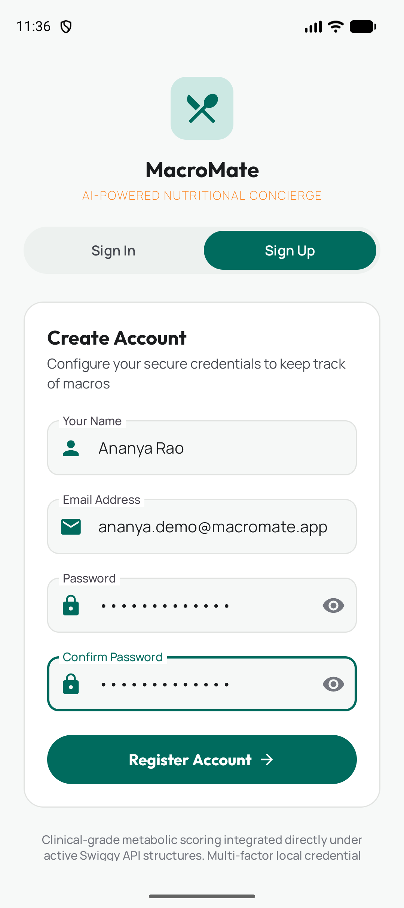
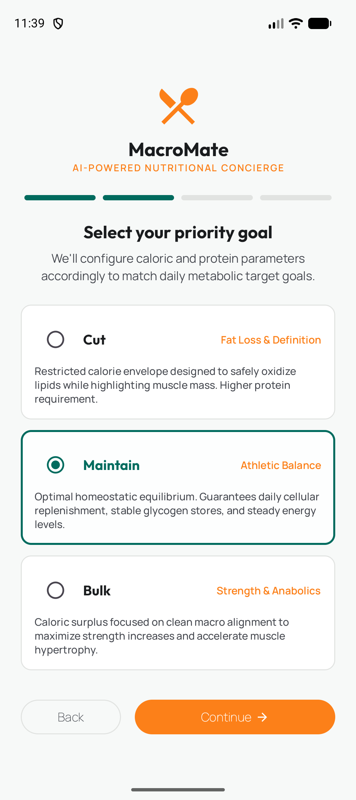
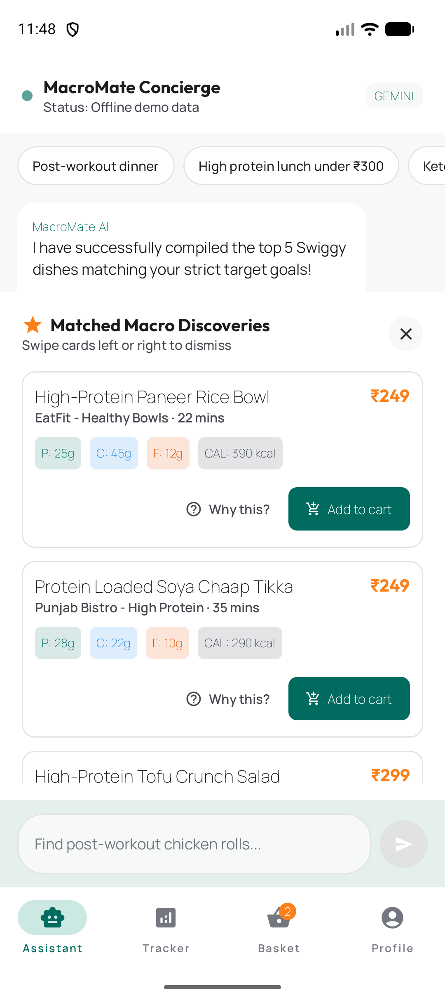
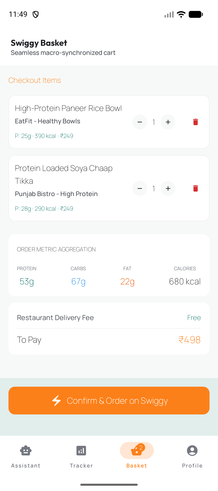
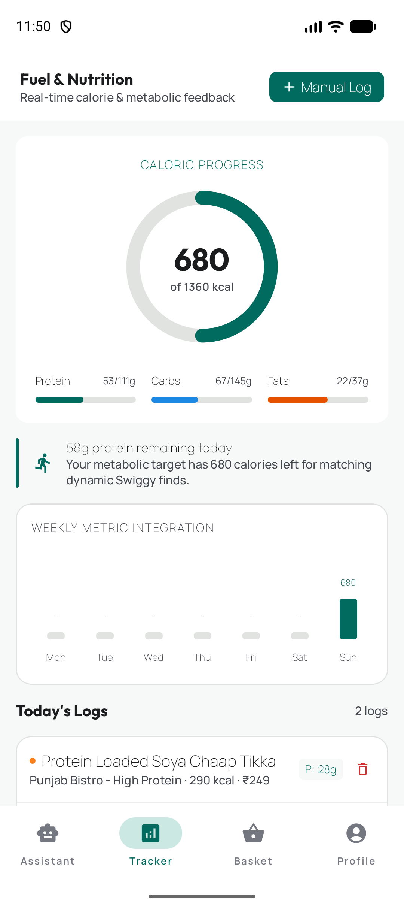
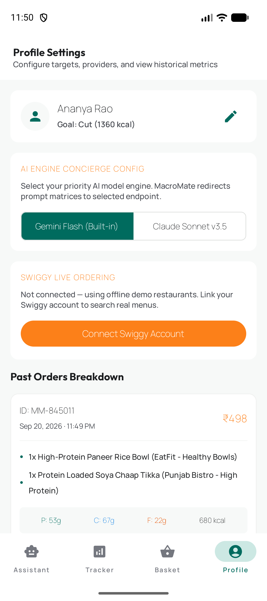

# MacroMate — AI-Powered Nutritional Swiggy Concierge 📱🥗

MacroMate is a high-fidelity, premium native Android application built with **Kotlin and Jetpack Compose** using Material Design 3. It serves as an intelligent nutritional concierge integrated with Swiggy to discover, rank, score, and checkout gourmet meals matching your physiological and micro-metabolic targets.

---

## 📸 Screenshots

<table>
  <tr>
    <td align="center" width="33%">
       
      <b>Sign Up</b>
    </td>
    <td align="center" width="33%">
       
      <b>Onboarding — Goal Selection</b>
    </td>
    <td align="center" width="33%">
       
      <b>AI Chat — Macro Discovery</b>
    </td>
  </tr>
  <tr>
    <td align="center" width="33%">
       
      <b>Basket / Cart</b>
    </td>
    <td align="center" width="33%">
       
      <b>Daily &amp; Weekly Tracker</b>
    </td>
    <td align="center" width="33%">
       
      <b>Profile &amp; Order History</b>
    </td>
  </tr>
</table>

See [`MacroMate_Documentation.pdf`](MacroMate_Documentation.pdf) for the full product & technical write-up, including every screen and state.

---

## 🎨 Creative Vibe & Design Concept
MacroMate is styled with our **"Neon Emerald & Slate" Athletic Theme**:
*   **Deep Navy-Slate Elements (`#0F172A`)** to ensure excellent contrast and prevent visual fatigue.
*   **Vibrant Neon Emerald (`#10B981`)** representing physical fitness, muscles, and target completions.
*   **Authentic Swiggy Orange (`#FC8019`)** representing swift deliveries and active carts.
*   **Dynamic Visual Elements**: Fully animated step transitions, manually calculated custom Canvas progress arcs, and beautifully responsive layout cards.

---

## 🚀 Screens Implemented

### 1. Onboarding Wizard (`OnboardingScreen`)
*   **Step 1**: Collects `Name`, `Age`, `Weight (kg)`, and `Height (cm)`.
*   **Step 2 (Goal Selector)**: Choose between **Cut** (fat loss, elevated protein), **Maintain** (metabolic balance), or **Bulk** (strength hyper-surplus). Daily macro limits are automatically calculated using the user's metabolic weight vectors.
*   **Step 3 (Dietary Limitations)**: Excludes dishes containing designated restrictive tags (e.g., *Vegetarian*, *Vegan*, *Gluten-Free*, *Nut Allergy*, *Dairy-Free*).
*   **Step 4 (Cuisine Preferences)**: Elevates selected cuisine choices (e.g., *North Indian*, *South Indian*, *Continental*, *Keto*, *Salads*) inside the scoring algorithms.
*   Saves securely to local **Room Database** schemas.

### 2. Conversational Concierge (`ChatScreen`)
*   Full-screen bubble dialogue (User-right, AI-left).
*   **ReAct Thinking Channel**: Fully displays active agent loop steps inline (e.g., `"Searching restaurants..."`, `"Analysing menus...`", `"Calculating macro congruence..."`) as they stream in real-time.
*   **Quick Prompts**: Touch suggestions like *"Post-workout dinner"* or *"High protein lunch under ₹300"* instantly trigger metabolic probes.

### 3. Matched Macro Discoveries (`ResultsScreen`)
*   Highly interactive slide-up swipe overlays displaying the top 5 food recommendations from Swiggy menus, sorted by calculated **Macro Matching Score**.
*   Swipe-to-dismiss capabilities: Drag cards left or right to exclude them from suggestions.
*   **Why This? AI Feedback**: Detail buttons triggering a custom-bound popup containing analytical explanations produced by the AI regarding the meal's nutrient profile.

### 4. Metabolic Tracker (`TrackerScreen`)
*   **Manually Rendered Arc Gauges**: Elegant Canvas progress rings showing calories consumed vs limit.
*   **Linear Macro Microbars**: Colored indicators tracking Protein (Emerald), Carbs (Indigo), and Fats (Amber).
*   **Historic Bar Chart**: Dynamic 7-day historic calories canvas chart drawn on-the-fly.
*   **Manual Log Modal**: Quickly enter non-Swiggy dishes (e.g., homemade shakes, eggs) to update progress counters instantly.

### 5. Swiggy Checkout Basket (`CartScreen`)
*   Presents items added during chat recommendations with reactive quantity controls.
*   Displays complete Cart Macro aggregate totals alongside the restaurant delivery summaries.
*   **Sync & Checkout**: Saves the order to historical Room logs and triggers a deep-link directly to Swiggy (`swiggy://cart`).

### 6. Profile & Settings (`ProfileScreen`)
*   Supports live editing of goals and metrics with synchronized macro recalculations.
*   **AI Engine Concierge Selector**: Segmented selector allowing toggling between **Gemini 3.5 Flash** and **Claude 3.5 Sonnet**.
*   Displays complete historical orders logged under your profile.

---

## 🤖 ReAct Agent & Tool Schemas
We implemented a robust local ReAct agent running on the device. It calls the following core tools:

1.  **`searchRestaurants`**
    *   Query-based location matching.
    *   Returns matching restaurants with their ratings, cuisines, distance elements, and price tiers.
2.  **`getMenuAndEstimateMacros`**
    *   Retrieves cuisines and items.
    *   Parses text elements and runs targeted calorie metrics. If a **Gemini API Key** is active, it prompts Gemini to estimate exact meal macros.
3.  **`addToCart`**
    ...Synchronizes item quantities to active checkouts.

### Scoring Formula:
$$\text{Score} = (0.5 \times \text{Protein Match}) + (0.3 \times \text{Calorie Match}) + (0.2 \times \text{Price Match})$$
Clamped strictly between $0.0$ and $1.0$.

---

## 🛠️ Setup & Secrets Management

MacroMate is fully ready for deployment. Follow these brief steps to run on your local device:

1.  **Configure API Keys**: Write your Gemini API key in the **Secrets panel in AI Studio** (which injects it at compile-time as `BuildConfig.GEMINI_API_KEY`).
2.  **Run Compilation**: Run `:app:assembleDebug` to build the final high-contrast android `.apk`.

*Note: If no API key is specified, MacroMate falls back to its highly realistic internal Indian Swiggy Mock engine, allowing 100% full conversational experience offline!*
